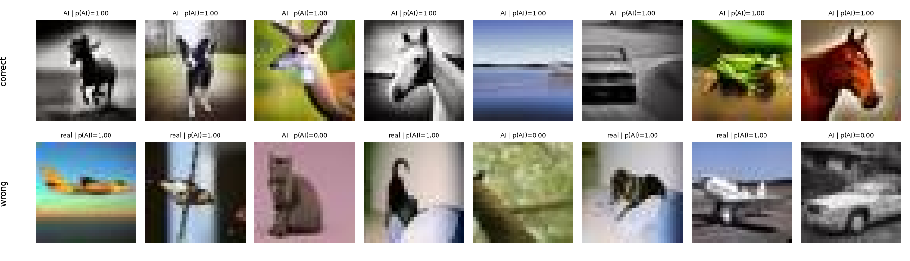
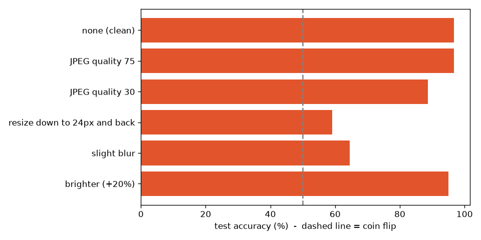

# Real photo or AI-generated?


A small CNN that looks at a 32x32 image and says whether it's a real photo or made by Stable Diffusion. On the test set it gets 96.8%. Then I shrank the images a little before testing, and most of the AI images started passing as real. That second part is the main thing I learned here.

## Data

[CIFAKE](https://arxiv.org/abs/2303.14126) by Jordan J. Bird and Ahmad Lotfi: 60,000 real images from CIFAR-10 and 60,000 images generated with Stable Diffusion 1.4 to look like the same 10 classes. All 32x32. I used the Hugging Face copy ([dragonintelligence/CIFAKE-image-dataset](https://huggingface.co/datasets/dragonintelligence/CIFAKE-image-dataset)), which keeps the original split: 100,000 train and 20,000 test, half real and half AI in both. The mirrors list it under the MIT license, same as CIFAR-10. `src/data.py` downloads it the first time; it isn't stored in the repo.

I held out 10% of the training set for validation and only touched the test set at the end.

## Models

| Model | Validation accuracy |
|---|---|
| Logistic regression on raw pixels (20k images) | 66.8% |
| Small CNN, 3 conv blocks, about 0.2M parameters, 8 epochs on CPU (12 min) | 96.9% |

The pixel baseline being well above 50% means even plain colors carry some signal. The CNN gets most of the way there after one epoch (88%).

## Test results

| | |
|---|---|
| Accuracy | 96.8% (20,000 images) |
| F1 | 0.968 |
| ROC AUC | 0.996 |
| Real photos called AI | 282 of 10,000 (2.8%) |
| AI images called real | 362 of 10,000 (3.6%) |



The top row is images it was most sure about and got right, the bottom row is the ones it was most sure about and got wrong. Some of the "real" photos it calls AI are honestly hard for me too, like the plane over the colorful sky.

## What breaks it

Images on the internet rarely stay untouched. They get compressed by WhatsApp, resized, screenshotted. So I applied a few of those changes to the test images (without retraining) and measured again:

| Change to the test images | Accuracy | AI images called real |
|---|---|---|
| None | 96.8% | 3.6% |
| JPEG quality 75 | 96.8% | 3.7% |
| Brighter by 20% | 95.0% | 6.3% |
| JPEG quality 30 | 88.6% | 21.2% |
| Slight blur | 64.6% | 70.8% |
| Shrink to 24px and back to 32px | 59.1% | **81.5%** |



Normal JPEG and brightness are fine. But a slight blur or a small resize wipes most of it out, and the mistakes all go one way: AI images get called real, almost never the opposite. My guess is that the model learned the fine pixel-level texture Stable Diffusion leaves behind, and blurring or resizing smooths exactly that away. So "this detector says it's real" is weak evidence if the image was resized on the way to you.

## Limits

- Everything is 32x32 and from one generator (Stable Diffusion 1.4, 2022). This says nothing about detecting full-size images from newer models. `predict.py` shrinks any image to 32x32 first, so treat its answer on your own photos as a toy.
- I didn't train with blur or resizing. That's the obvious next step: add them as augmentation and check whether it holds up on changes it hasn't seen.

## Run it

```bash
python -m venv .venv
.venv/Scripts/pip install -r requirements.txt   # or .venv/bin/pip on Linux/Mac
python src/train.py       # about 12 minutes on CPU, writes models/cnn.pt
python src/evaluate.py    # writes reports/results.json and the figures
python src/predict.py some_image.jpg
pytest -q
```

## Files

```
src/data.py       download + cache CIFAKE, validation split
src/model.py      the CNN and preprocessing
src/train.py      baseline + CNN training
src/evaluate.py   test metrics and the robustness table
src/predict.py    run the model on your own images
reports/          results.json, train_log.json, figures
models/cnn.pt     trained weights (0.8 MB)
```
